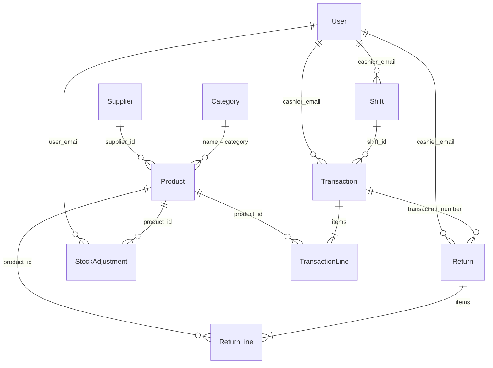

# B12 Store Solution

A centralized retail management system: real-time inventory oversight, cashier point-of-sale with thermal receipt printing, product returns, profitability analytics, purchasing/suppliers, and a separate wholesale workflow.

Stack: React + Vite + Tailwind CSS (shadcn/ui) on the Base44 platform (auth, database, integrations, hosting).

---

## Running locally

1. Clone the repository.
2. `npm install`
3. Create `.env.local`:

```
VITE_BASE44_APP_ID=your_app_id
VITE_BASE44_APP_BASE_URL=your_backend_url
```

4. `npm run dev`
5. Publish changes with the **Publish** button in the Base44 editor.

---

## Database overview

Data is stored in Base44 **entities** (`base44/entities/<Name>.jsonc`). Each entity is one table; its `properties` are the columns.

Every table automatically has these built-in columns (never declared in the schema files):

| Column | Type | Notes |
| --- | --- | --- |
| `id` | string | Primary key |
| `created_date` | datetime | Set on insert |
| `updated_date` | datetime | Set on every update |
| `created_by_id` | string | User id of the record creator |

Money is stored as a plain number (2 decimals); quantities are numbers; percentages (`tax_rate`) are stored as whole percentages (e.g. `10` = 10%).

Two portable copies of the schema live in this repository:

| File | Purpose |
| --- | --- |
| `docs/schema/schema.sql` | Full PostgreSQL DDL for all 8 tables, foreign keys, indexes and check constraints — run it to create the database outside Base44. |
| `docs/schema/all-entities.json` | All entity JSON schemas in one bundle — copy any block to bootstrap a new entity/schema. |

---

## Tables

### 1. `User` — application users
The built-in platform user table, extended with a role and a display name. Accounts are created by administrators only.

| Column | Type | Required | Notes |
| --- | --- | --- | --- |
| `role` | string | yes | `admin` or `user` |
| `display_name` | string | no | Full name shown across POS, returns and admin screens |
| `email` | string | — | Built-in, unique |
| `full_name` | string | — | Built-in |

### 2. `Category` — product categories
| Column | Type | Required | Notes |
| --- | --- | --- | --- |
| `name` | string | yes | Category name; referenced by `Product.category` |

### 3. `Supplier` — vendors
| Column | Type | Required | Notes |
| --- | --- | --- | --- |
| `name` | string | yes | Company name |
| `contact_name` | string | no | Primary contact |
| `email` | string | no | Contact email |
| `phone` | string | no | Contact phone |
| `address` | string | no | Business address |
| `notes` | string | no | Free-text notes |
| `is_active` | boolean | no | Default `true` |

### 4. `Product` — catalog and stock
| Column | Type | Required | Notes |
| --- | --- | --- | --- |
| `name` | string | yes | Product name |
| `sku` | string | yes | Stock keeping unit code |
| `barcode` | string | no | UPC/EAN |
| `category` | string | no | Category **name** (denormalized from `Category`) |
| `selling_price` | number | yes | Retail price charged to customers |
| `wholesale_price` | number | no | Bulk price per unit, default `0` (retail price used when unset) |
| `cost_price` | number | no | Supplier cost, used for margin/profit |
| `stock_quantity` | number | no | Current stock on hand |
| `low_stock_threshold` | number | no | Low-stock alert level, default `10` |
| `tax_rate` | number | no | Tax percentage, default `0` (e.g. `10` = 10%) |
| `is_active` | boolean | no | Available for sale, default `true` |
| `image_url` | string | no | Product image (public file URL) |
| `supplier_id` | string | no | → `Supplier.id` |

### 5. `Transaction` — retail sales and wholesale orders
| Column | Type | Required | Notes |
| --- | --- | --- | --- |
| `transaction_number` | string | yes | `TX-…` for retail, `WS-…` for wholesale |
| `sale_type` | string | no | `retail` (default) or `wholesale` |
| `customer_name` | string | no | Wholesale business/customer |
| `cashier_email` | string | yes | → `User.email` |
| `cashier_name` | string | no | Display name at time of sale |
| `items` | array | no | Line items (see below) |
| `subtotal` | number | no | Before tax and discount |
| `tax_total` | number | no | Total tax |
| `discount_amount` | number | no | Default `0` |
| `grand_total` | number | yes | Final amount due |
| `total_cost` | number | no | Cost of goods sold |
| `gross_profit` | number | no | `grand_total - total_cost` |
| `payment_method` | string | yes | `cash`, `card` or `electronic` |
| `amount_paid` | number | no | Tendered amount |
| `change_given` | number | no | Change returned |
| `shift_id` | string | no | → `Shift.id` |
| `status` | string | no | `completed` (default), `refunded`, `voided` |

Line item (`items[]`): `product_id`, `product_name`, `sku`, `quantity`, `unit_price`, `cost_price`, `tax_rate`, `tax_amount`, `line_total`. Prices and names are **snapshotted** at sale time so later product edits never change historical receipts.

### 6. `Return` — refunds against a sale
| Column | Type | Required | Notes |
| --- | --- | --- | --- |
| `return_number` | string | yes | `RT-…` |
| `original_transaction_number` | string | no | → `Transaction.transaction_number` |
| `cashier_email` | string | yes | → `User.email` |
| `cashier_name` | string | no | Display name at time of return |
| `items` | array | no | Returned line items (see below) |
| `total_refund` | number | yes | Amount refunded |
| `total_cost_recovered` | number | no | Cost value returned to inventory |
| `total_cost_lost` | number | no | Cost value written off (damaged) |
| `profit_impact` | number | no | Negative effect on profit |
| `refund_method` | string | yes | `cash`, `card`, `electronic`, `store_credit` |
| `reason` | string | no | Reason for the return |
| `status` | string | no | `processed` (default) or `voided` |

Line item (`items[]`): `product_id`, `product_name`, `sku`, `quantity`, `unit_price`, `cost_price`, `refund_amount`, `condition` (`good` → restocked, `damaged` → written off), `restocked`, `cost_recovered`, `cost_lost`, `profit_impact`.

### 7. `Shift` — cashier till sessions
| Column | Type | Required | Notes |
| --- | --- | --- | --- |
| `cashier_email` | string | yes | → `User.email` |
| `cashier_name` | string | no | Display name |
| `start_time` | datetime | yes | Shift opened |
| `end_time` | datetime | no | Shift closed |
| `status` | string | yes | `open` (default) or `closed` |
| `total_cash_sales` | number | no | Default `0` |
| `total_card_sales` | number | no | Default `0` |
| `total_electronic_sales` | number | no | Default `0` |
| `total_revenue` | number | no | Default `0` |
| `total_transactions` | number | no | Default `0` |
| `total_cost` | number | no | Cost of goods sold in the shift |
| `total_profit` | number | no | Shift gross profit |

### 8. `StockAdjustment` — manual stock change audit log
| Column | Type | Required | Notes |
| --- | --- | --- | --- |
| `product_id` | string | yes | → `Product.id` |
| `product_name` | string | yes | Name snapshot |
| `sku` | string | no | SKU snapshot |
| `previous_quantity` | number | yes | Stock before |
| `new_quantity` | number | yes | Stock after |
| `delta` | number | no | `new - previous` |
| `reason` | string | yes | Why the adjustment was made |
| `user_email` | string | yes | → `User.email` |
| `user_name` | string | no | Display name |

---

## Relationships

| From | To | Cardinality | Key | Notes |
| --- | --- | --- | --- | --- |
| `Product.supplier_id` | `Supplier.id` | many → 1 | optional | Product has at most one supplier |
| `Product.category` | `Category.name` | many → 1 | by name | Denormalized text reference, not an id |
| `Transaction.items[].product_id` | `Product.id` | many → 1 | embedded | Line items live inside the transaction document |
| `Transaction.shift_id` | `Shift.id` | many → 1 | optional | Sales made during a shift |
| `Transaction.cashier_email` | `User.email` | many → 1 | required | Cashier who rang the sale |
| `Shift.cashier_email` | `User.email` | many → 1 | required | Cashier who opened the shift |
| `Return.cashier_email` | `User.email` | many → 1 | required | Who processed the refund |
| `Return.original_transaction_number` | `Transaction.transaction_number` | many → 1 | optional | No receipt number = manual return |
| `Return.items[].product_id` | `Product.id` | many → 1 | embedded | Restocked/written-off units |
| `StockAdjustment.product_id` | `Product.id` | many → 1 | required | Every change to stock |
| `StockAdjustment.user_email` | `User.email` | many → 1 | required | Admin who adjusted stock |

### ER diagram



`TransactionLine` and `ReturnLine` are embedded arrays (`Transaction.items`, `Return.items`) rather than standalone tables — they are shown separately here because `docs/schema/schema.sql` normalizes them into `transaction_items` and `return_items`.

---

## Access control (row-level security)

| Table | Read | Create | Update | Delete |
| --- | --- | --- | --- | --- |
| `User` | own record / admins | admins only (invite) | admins | admins |
| `Category` | everyone signed in | admin | admin | admin |
| `Supplier` | admin | admin | admin | admin |
| `Product` | active products for all; inactive only admins | admin | admin | admin |
| `Transaction` | own sales for cashiers; all for admins | own cashier email or admin | admin | admin |
| `Return` | own returns for cashiers; all for admins | own cashier email or admin | admin | admin |
| `Shift` | own shift for cashiers; all for admins | own cashier email or admin | own shift or admin | admin |
| `StockAdjustment` | admin | own email or admin | admin | admin |

Cashier-facing writes are always restricted to records carrying the signed-in user's email, so one cashier cannot modify another's sales, shifts or returns.

---

## Conventions

- **Price snapshots** — line items copy `product_name`, `sku`, `unit_price` and `cost_price` so historical documents stay accurate after catalog changes.
- **Money fields** — `selling_price`, `cost_price`, `subtotal`, `grand_total`, margins, etc. are numbers, never strings.
- **Sale type** — `Transaction.sale_type` splits retail from wholesale; wholesale orders use `wholesale_price` when set, otherwise the retail price.
- **Stock movements** — sales decrement `Product.stock_quantity`; returns restock `good` items only; every manual change writes a `StockAdjustment`.
- **Naming** — `*_email` columns hold user emails (the value available in RLS rules), `*_id` columns hold record ids.

---

## Creating a new table

### On Base44 (recommended for the app)

1. Add `base44/entities/<NewTable>.jsonc`.
2. Write the schema — a `name`, `type: "object"`, `properties`, `required`, and optional `rls`. Only the fields the app needs; `id`, `created_date`, `updated_date`, `created_by_id` are automatic.
3. Use it through the SDK: `base44.entities.<NewTable>.create({...})`, `.filter()`, `.update(id, {...})`, `.delete(id)`.

Minimal template:

```jsonc
{
  "name": "NewTable",
  "type": "object",
  "properties": {
    "name": { "type": "string", "description": "Human readable name" },
    "product_id": { "type": "string", "description": "ID of the linked product" },
    "amount": { "type": "number", "default": 0 },
    "status": { "type": "string", "enum": ["open", "closed"], "default": "open" },
    "is_active": { "type": "boolean", "default": true }
  },
  "required": ["name"],
  "rls": {
    "create": { "user_condition": { "role": "admin" } },
    "read": {},
    "update": { "user_condition": { "role": "admin" } },
    "delete": { "user_condition": { "role": "admin" } }
  }
}
```

### In any PostgreSQL database

`docs/schema/schema.sql` creates the complete schema. Append a new table to the same file, following its pattern:

```sql
CREATE TABLE IF NOT EXISTS new_table (
  id            text PRIMARY KEY,
  name          text NOT NULL,
  product_id    text REFERENCES products(id) ON DELETE SET NULL,
  amount        numeric(12,2) NOT NULL DEFAULT 0,
  status        text NOT NULL DEFAULT 'open' CHECK (status IN ('open','closed')),
  is_active     boolean NOT NULL DEFAULT true,
  created_date  timestamptz NOT NULL DEFAULT now(),
  updated_date  timestamptz NOT NULL DEFAULT now(),
  created_by_id text
);
CREATE INDEX IF NOT EXISTS idx_new_table_product ON new_table(product_id);
``